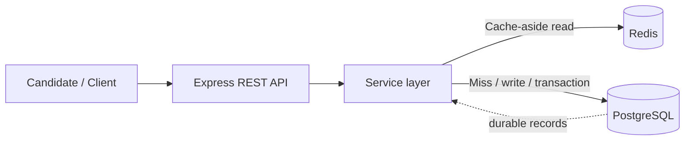

# Exam Database HLD — PostgreSQL + Redis

A runnable starter implementation for **Task 3: Database Selection** in a high-level design exercise. It uses PostgreSQL as the durable source of truth and Redis as an optional cache.

## Architecture



## Data model

- `candidates`: candidate profile
- `exams`: exam metadata
- `questions`: questions belonging to an exam
- `exam_answers`: candidate answers, unique per candidate/exam/question
- `exam_submissions`: final submission and score

PostgreSQL enforces primary keys, foreign keys, unique constraints, and transactional consistency. Redis stores only derived/read-through data and is never the permanent store for submissions or results.

## Start locally

Requirements: Node.js 20+, Docker Desktop or Docker Engine.

```bash
cp .env.example .env
docker compose up -d
npm install
npm run migrate
npm start
```

API runs at `http://localhost:3000`. Health check: `GET /health`.

## API endpoints

| Method | Endpoint | Purpose |
|---|---|---|
| GET | `/api/exams` | List exams |
| POST | `/api/exams` | Create exam |
| GET | `/api/exams/:id` | Get exam and questions (cache-aside) |
| POST | `/api/exams/:id/questions` | Add question |
| POST | `/api/candidates` | Create candidate |
| PUT | `/api/exams/:examId/answers/:questionId` | Save/update an answer |
| POST | `/api/exams/:examId/submit` | Submit exam and calculate score transactionally |
| GET | `/api/candidates/:candidateId/results` | Read candidate results |

## Example requests

Create a candidate:
```bash
curl -X POST http://localhost:3000/api/candidates \
  -H "Content-Type: application/json" \
  -d '{"name":"Asha","email":"asha@example.com"}'
```

Create an exam:
```bash
curl -X POST http://localhost:3000/api/exams \
  -H "Content-Type: application/json" \
  -d '{"title":"Database Basics","description":"Sample exam","duration_minutes":30}'
```

Create a multiple-choice question (replace `EXAM_ID`):
```bash
curl -X POST http://localhost:3000/api/exams/EXAM_ID/questions \
  -H "Content-Type: application/json" \
  -d '{"prompt":"Which database is relational?","options":["PostgreSQL","Redis"],"correct_answer":"PostgreSQL","points":1}'
```

Save an answer (replace IDs):
```bash
curl -X PUT http://localhost:3000/api/exams/EXAM_ID/answers/QUESTION_ID \
  -H "Content-Type: application/json" \
  -d '{"candidate_id":"CANDIDATE_ID","answer":"PostgreSQL"}'
```

Submit:
```bash
curl -X POST http://localhost:3000/api/exams/EXAM_ID/submit \
  -H "Content-Type: application/json" \
  -d '{"candidate_id":"CANDIDATE_ID"}'
```

## Cache strategy

- `GET /api/exams/:id` checks Redis first.
- On a miss, it loads the exam and questions from PostgreSQL and caches the result for `CACHE_TTL_SECONDS`.
- Creating an exam or adding a question invalidates that exam's cache key.
- Redis read/write errors are treated as cache failures: the API falls back to PostgreSQL.
- Answer saving and final submission write to PostgreSQL, not Redis.
- Final submission uses a database transaction and is idempotent for an already-submitted candidate/exam pair.

## Configuration and security notes

- Copy `.env.example` to `.env`; never commit secrets.
- Replace the sample local database password before deployment.
- Add authentication/authorization, rate limiting, schema validation, and migrations in a production deployment. This sample intentionally keeps the implementation focused on database selection and cache behavior.

## Testing

```bash
npm test
```

The included tests cover service-level cache-aside behavior using fake adapters and do not require live database services. Integration testing against PostgreSQL and Redis requires starting the services and running the setup commands above.
